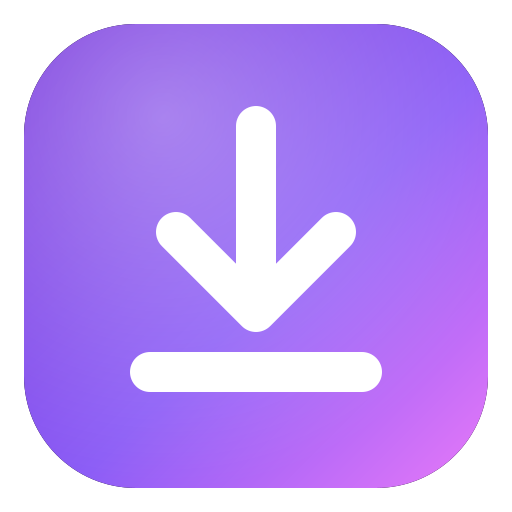
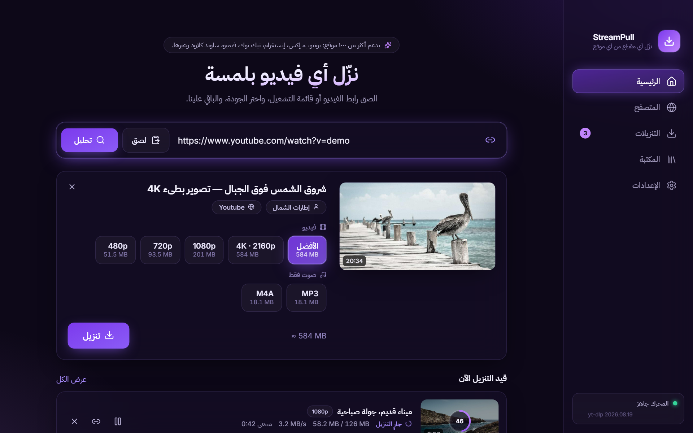
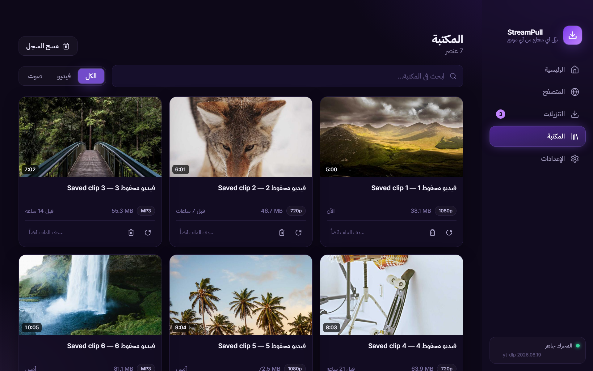
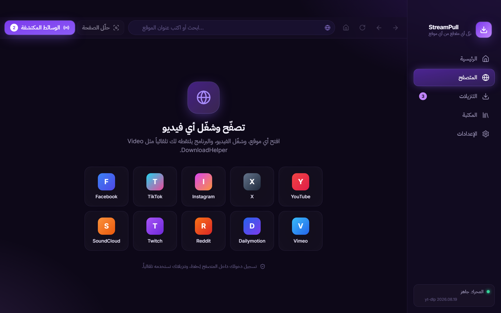
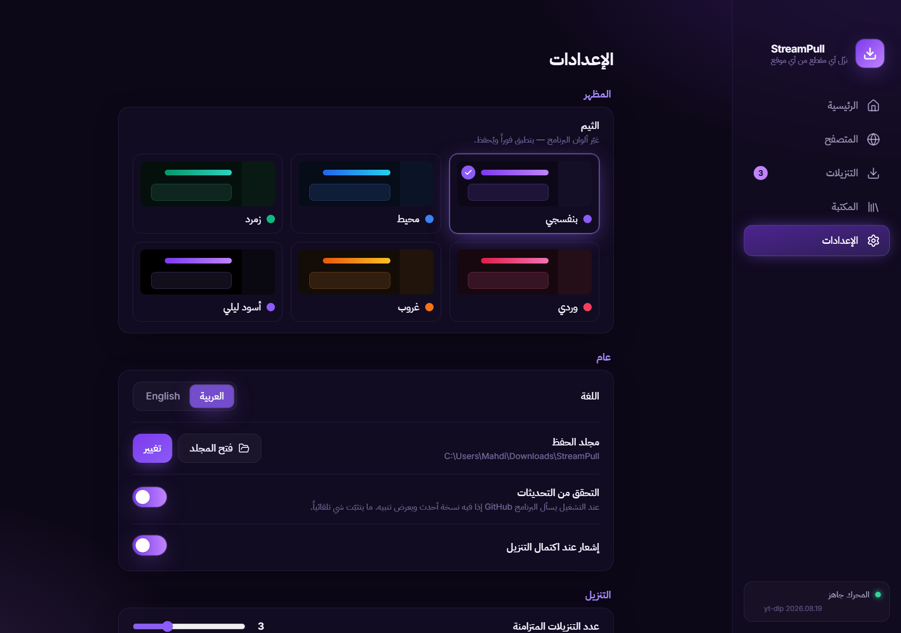

<div align="center" dir="rtl">



# StreamPull

**نزّل الفيديو والصوت من أي موقع تقريباً — بتطبيق مكتبي حديث مع ثيمات ألوان تقدر تبدّلها.**


العربية · [English](README.md)



</div>

<div dir="rtl">

StreamPull بديل مكتبي لإضافات المتصفح مثل *Video DownloadHelper*: الصق الرابط، **أو** تصفّح داخل
البرنامج ودعه يلتقط الفيديوهات لك. يعمل بمحرك [yt-dlp](https://github.com/yt-dlp/yt-dlp)
(أكثر من ١٠٠٠ موقع) و[FFmpeg](https://ffmpeg.org).

## المميزات

- **الصق الرابط واختر الجودة** — كل الدقات المتاحة مع الحجم التقريبي، أو الصوت فقط (MP3 / M4A).
- **متصفح مدمج يكتشف الوسائط** — شغّل أي فيديو في الصفحة فيظهر في لوحة *الوسائط المكتشفة*
  (ملفات مباشرة، وبثوث HLS وDASH). تسجيل دخولك يُحفظ ويُستخدم في التنزيل. فيه **تبويبات** و**مانع إعلانات**
  و**مفضلة** و**سجل تصفح**.
- **قوائم التشغيل** — حدّد وابحث ونزّل عدة عناصر دفعة واحدة.
- **قنوات يوتيوب** — الصق رابط القناة، واختر **الفيديوهات** أو **الشورتات** أو **البثوث**، ثم حدّد الكل
  أو اللي تبيه فقط (البثوث الجارية والقادمة تُستثنى تلقائياً).
- **حسابات تيك توك وإنستغرام** — الصق رابط الحساب واختر أي المنشورات تنزّل. تيك توك يشتغل مباشرة. أما إنستغرام فيعرض
  الحسابات الكاملة للمسجّلين فقط، فقائمة الحساب تحتاج تسجيل دخول لمرة واحدة داخل المتصفح المدمج (والبرنامج يستخدم جلستك
  بعدها). أما روابط المنشورات والريلز العامة المباشرة فتشتغل بدون تسجيل دخول.
- **طابور ذكي** — تنزيلات متوازية، إيقاف مؤقت واستئناف وإلغاء وإعادة محاولة، مع السرعة والوقت المتبقي.
- **مكتبة** — سجل بحث وفلاتر، وفتح الملف، وإظهاره في المجلد، وإعادة التنزيل.
- **ثيمات ألوان** — بنفسجي، محيط، زمرد، وردي، غروب، أو أسود ليلي؛ غيّره متى شئت من *الإعدادات ← المظهر*.
- **عربي أولاً مع الإنجليزية** — واجهة RTL كاملة، وتبديل اللغة في أي وقت.
- **محرك يتحدّث تلقائياً** — يتجدّد yt-dlp يومياً لأن المواقع تتغيّر باستمرار.
- **خصوصية** — بدون حسابات ولا تتبّع، ولا يخرج من جهازك شيء إلا التنزيلات التي تبدأها.

<p align="center">
  
  
</p>
<p align="center">
  
</p>

## التنزيل

نزّل أحدث نسخة لويندوز من صفحة [**الإصدارات**](../../releases):

| الملف | وش هو |
| --- | --- |
| `StreamPull-Setup-x.y.z.exe` | مثبّت (يضيف اختصاراً في قائمة ابدأ ومزيل تثبيت) |
| `StreamPull-x.y.z-portable.exe` | نسخة محمولة — شغّلها من أي مكان بدون تثبيت |

> **قريباً:** نسخ ماك ولينكس مخطط لها خلال الأيام القادمة.
> اضغط Star أو Watch على المستودع عشان يوصلك إشعار لما تنزل.

**الإصدارات غير موقّعة حالياً**، فقد يحذّرك SmartScreen في ويندوز أول مرة:
*مزيد من المعلومات ← تشغيل على أي حال*.

عند أول تشغيل ينزّل البرنامج **yt-dlp** و**FFmpeg** (حوالي ٥٠ ميجا، مرة واحدة) داخل مجلد بياناته.

## البناء من المصدر

يحتاج Node.js 22 أو أحدث.

```bash
git clone https://github.com/Mahaadi-dis/streampull.git
cd streampull
npm ci
npm run dev          # تشغيل التطبيق مع التحديث الفوري
npm run typecheck    # فحص TypeScript
npm test             # الاختبارات
npm run dist:win     # يبني مثبّت ويندوز والنسخة المحمولة في ./release
```

الأمران `dist:mac` و`dist:linux` موجودان أيضاً، لكن هذي الأنظمة **لم تُصدر ولم تُختبر بعد** (قريباً).
ويجب بناء كل مثبّت على نظامه نفسه.

## القيود

- الخدمات المحمية بـ **DRM** (نتفليكس، ديزني+ …) غير مدعومة ولن تُدعم.
- تسجيل الدخول بحساب **Google** داخل المتصفح المدمج تحجبه Google غالباً.
- مانع الإعلانات يحتاج إنترنت أول مرة عشان ينزّل قوائم الفلترة (EasyList وEasyPrivacy وتتحدث أسبوعياً)، وقبلها تشتغل قائمة صغيرة مدمجة لشبكات الإعلانات.
- عند التشغيل يسأل البرنامج GitHub عن آخر إصدار ويعرض تنبيهاً إذا فيه نسخة أحدث (تقدر توقفه من الإعدادات). ما يتنزّل ولا يتثبّت شي تلقائياً.
- نسخ ماك ولينكس قادمة قريباً (انظر أعلاه).

## تنبيه قانوني

StreamPull أداة عامة. **نزّل فقط المحتوى الذي تملكه أو المسموح لك بتنزيله**، والتزم بحقوق النشر
وشروط استخدام كل موقع. لا يشجّع المطورون على القرصنة ولا يتحملون مسؤولية طريقة استخدام البرنامج،
والبرنامج لا يتجاوز حماية DRM.

## المساهمة

الـ Issues والـ Pull Requests مرحّب بها — راجع [CONTRIBUTING.md](CONTRIBUTING.md).
الترجمة مجرد ملفَّي JSON في `src/renderer/src/i18n/`.

## الرخصة

[MIT](LICENSE). المكوّنات الخارجية مذكورة في [THIRD_PARTY_NOTICES.md](THIRD_PARTY_NOTICES.md).

</div>
