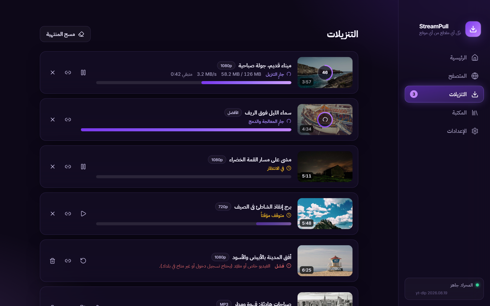

<div align="center" dir="rtl">


# StreamPull

**نزّل الفيديو والصوت من أي موقع تقريباً — تطبيق مكتبي حديث لويندوز وتطبيق لأندرويد، مع ثيمات ألوان تقدر تبدّلها.**


العربية · [English](README.md)


</div>

<div dir="rtl">

StreamPull بديل مكتبي (ومن الإصدار 0.4.0 لأندرويد كذلك) لإضافات المتصفح مثل *Video DownloadHelper*: الصق الرابط، **أو** تصفّح داخل
البرنامج ودعه يلتقط الفيديوهات لك. يعمل بمحرك [yt-dlp](https://github.com/yt-dlp/yt-dlp)
(أكثر من ١٠٠٠ موقع) و[FFmpeg](https://ffmpeg.org).

## المميزات

- **الصق الرابط واختر الجودة** — كل الدقات المتاحة مع الحجم التقريبي، أو الصوت فقط (MP3 / M4A).
- **متصفح مدمج يكتشف الوسائط** — شغّل أي فيديو في الصفحة فيظهر في لوحة *الوسائط المكتشفة*
  (ملفات مباشرة، وبثوث HLS وDASH). تسجيل دخولك يُحفظ ويُستخدم في التنزيل. فيه **تبويبات** و**مانع إعلانات**
  و**مفضلة** و**سجل تصفح**.
- **قوائم التشغيل** — حدّد وابحث ونزّل عدة عناصر دفعة واحدة.
- **قنوات يوتيوب** — الصق رابط القناة، واختر **الفيديوهات** أو **الشورتات** أو **البثوث**، ثم حدّد الكل
  أو اللي تبيه فقط (البثوث الجارية والقادمة تُستثنى تلقائياً).
- **حسابات تيك توك وإنستغرام** — الصق رابط الحساب واختر أي المنشورات تنزّل. تيك توك يشتغل مباشرة. أما إنستغرام فيعرض
  الحسابات الكاملة للمسجّلين فقط، فقائمة الحساب تحتاج تسجيل دخول لمرة واحدة داخل المتصفح المدمج (والبرنامج يستخدم جلستك
  بعدها). أما روابط المنشورات والريلز العامة المباشرة فتشتغل بدون تسجيل دخول.
- **طابور ذكي** — تنزيلات متوازية، إيقاف مؤقت واستئناف وإلغاء وإعادة محاولة، مع السرعة والوقت المتبقي.
- **مكتبة** — سجل بحث وفلاتر، وفتح الملف، وإظهاره في المجلد، وإعادة التنزيل.
- **ثيمات ألوان** — بنفسجي، محيط، زمرد، وردي، غروب، أو أسود ليلي؛ غيّره متى شئت من *الإعدادات ← المظهر*.
- **عربي أولاً مع الإنجليزية** — واجهة RTL كاملة، وتبديل اللغة في أي وقت.
- **على جوالك كذلك** — تطبيق أندرويد يسوي نفس الشغل: الصق الرابط أو **شاركه من أي تطبيق**، اختر الجودة، وتجيك إشعارات والتنزيل شغال بالخلفية (انظر [أندرويد](#أندرويد)).
- **محرك يتحدّث تلقائياً** — يتجدّد yt-dlp يومياً لأن المواقع تتغيّر باستمرار.
- **خصوصية** — بدون حسابات ولا تتبّع، ولا يخرج من جهازك شيء إلا التنزيلات التي تبدأها.

<p align="center">
  
  
</p>
<p align="center">
  
  
</p>

### ست ثيمات ألوان

بنفسجي ومحيط وزمردي وورد وغروب وأسود منتصف الليل — في تطبيق الكمبيوتر وتطبيق أندرويد، بالعربي والإنجليزي.

<p align="center">
  
</p>

### على أندرويد

<p align="center">
  
  
  
  
</p>
<p align="center">
  
</p>

<details>
<summary>الواجهة الإنجليزية</summary>

<p align="center">
  
</p>
<p align="center">
  
  
  
  
</p>
<p align="center">
  
</p>

</details>

## التنزيل

نزّل أحدث نسخة من صفحة [**الإصدارات**](../../releases). **ويندوز:**

| الملف | وش هو |
| --- | --- |
| `StreamPull-Setup-x.y.z.exe` | مثبّت (يضيف اختصاراً في قائمة ابدأ ومزيل تثبيت) |
| `StreamPull-x.y.z-portable.exe` | نسخة محمولة — شغّلها من أي مكان بدون تثبيت |

**متطلبات التشغيل**

- ويندوز 10 أو 11 (64 بت). ويندوز 7/8/8.1 وويندوز 32 بت غير مدعومين من Electron. ويندوز على معالجات ARM
  (Surface وحاسبات Snapdragon) يشتغل عبر محاكاة x64 المدمجة في ويندوز.
- إنترنت أول مرة: البرنامج ينزّل أداتيه المساعدتين (yt-dlp وFFmpeg، حوالي 50 ميغا). ويحترم إعدادات البروكسي
  والـVPN في النظام. لو صار خلل، **الإعدادات ← محرك التنزيل ← التشخيص** يبيّن بالضبط شنو المحجوب.
- كل رفع يُختبر من البداية للنهاية على أجهزة ويندوز نظيفة (Server 2022 وServer 2025 وويندوز 11 ARM)، مع مجلدات
  بأسماء عربية وتكبير شاشة 175%.

### أندرويد

من الإصدار 0.4.0 تلقى في صفحة الإصدارات تطبيق **أندرويد** (Flutter، في المجلد [`mobile/`](mobile)):
الملف `StreamPull-x.y.z-android-arm64-v8a.apk` يناسب تقريباً كل جوالات السنوات الأخيرة (الجوالات القديمة 32 بت:
`armeabi-v7a`، والمحاكيات: `x86_64`). يحتاج أندرويد 10 أو أحدث، وقد تحتاج تسمح بـ"تثبيت التطبيقات غير المعروفة" لمتصفحك
أو مدير الملفات مرة وحدة، وتقدر **تشارك رابط من أي تطبيق** (يوتيوب، تيك توك، إنستغرام …) مباشرة على StreamPull.
الملفات تنحفظ في `Downloads/StreamPull`. تطبيق أندرويد مرخّص GPL‑3.0 (راجع [mobile/LICENSE](mobile/LICENSE))
وما فيه متصفح داخلي للحين.

> **قريباً:** نسخ ماك ولينكس مخطط لها خلال الأيام القادمة.
> اضغط Star أو Watch على المستودع عشان يوصلك إشعار لما تنزل.

**الإصدارات غير موقّعة حالياً**، فقد يحذّرك SmartScreen في ويندوز أول مرة:
*مزيد من المعلومات ← تشغيل على أي حال*.

عند أول تشغيل ينزّل البرنامج **yt-dlp** و**FFmpeg** (حوالي ٥٠ ميجا، مرة واحدة) داخل مجلد بياناته.

## البناء من المصدر

**المكتبي** — يحتاج Node.js 22 أو أحدث. (تطبيق أندرويد يُبنى بطريقة ثانية، راجع [mobile/README.md](mobile/README.md).)

```bash
git clone https://github.com/Mahaadi-dis/streampull.git
cd streampull
npm ci
npm run dev          # تشغيل التطبيق مع التحديث الفوري
npm run typecheck    # فحص TypeScript
npm test             # الاختبارات
npm run dist:win     # يبني مثبّت ويندوز والنسخة المحمولة في ./release
```

الأمران `dist:mac` و`dist:linux` موجودان أيضاً، لكن هذي الأنظمة **لم تُصدر ولم تُختبر بعد** (قريباً).
ويجب بناء كل مثبّت على نظامه نفسه.

## القيود

- الخدمات المحمية بـ **DRM** (نتفليكس، ديزني+ …) غير مدعومة ولن تُدعم.
- تسجيل الدخول بحساب **Google** داخل المتصفح المدمج تحجبه Google غالباً.
- مانع الإعلانات يحتاج إنترنت أول مرة عشان ينزّل قوائم الفلترة (EasyList وEasyPrivacy وتتحدث أسبوعياً)، وقبلها تشتغل قائمة صغيرة مدمجة لشبكات الإعلانات.
- عند التشغيل يسأل البرنامج GitHub عن آخر إصدار ويعرض تنبيهاً إذا فيه نسخة أحدث (تقدر توقفه من الإعدادات). ما يتنزّل ولا يتثبّت شي تلقائياً.
- تطبيق أندرويد ما فيه متصفح مدمج للحين (المكتبي فيه)، وملفات الـAPK مو على Google Play لأن Google ما تسمح بتطبيقات تنزيل من مواقع مثل يوتيوب، فتثبّت الـAPK من صفحة الإصدارات.
- نسخ ماك ولينكس قادمة قريباً (انظر أعلاه).

## تنبيه قانوني

StreamPull أداة عامة. **نزّل فقط المحتوى الذي تملكه أو المسموح لك بتنزيله**، والتزم بحقوق النشر
وشروط استخدام كل موقع. لا يشجّع المطورون على القرصنة ولا يتحملون مسؤولية طريقة استخدام البرنامج،
والبرنامج لا يتجاوز حماية DRM.

## المساهمة

الـ Issues والـ Pull Requests مرحّب بها — راجع [CONTRIBUTING.md](CONTRIBUTING.md).
الترجمة مجرد ملفَّي JSON في `src/renderer/src/i18n/`.

## الرخصة

التطبيق المكتبي [MIT](LICENSE). وتطبيق أندرويد في [`mobile/`](mobile) برخصة [GPL‑3.0](mobile/LICENSE) لأنه يضمّ `youtubedl-android`. المكوّنات الخارجية مذكورة في [THIRD_PARTY_NOTICES.md](THIRD_PARTY_NOTICES.md).

</div>
