<div align="center">


# StreamPull

**Download videos and audio from almost any site — a modern desktop app for Windows and an Android app, with switchable color themes.**


[العربية](README.ar.md) · English

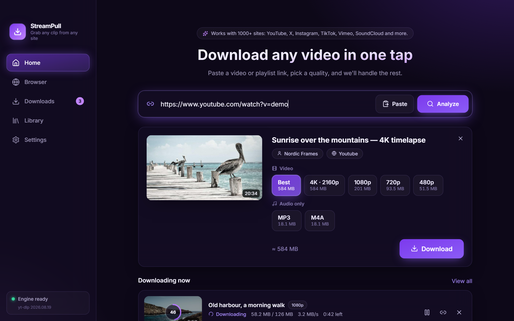

</div>

StreamPull is a desktop (and, new in 0.4.0, Android) alternative to browser extensions like *Video DownloadHelper*: paste a link
**or** browse inside the app and let it catch the videos for you. It is powered by
[yt-dlp](https://github.com/yt-dlp/yt-dlp) (1000+ supported sites) and [FFmpeg](https://ffmpeg.org).

## Features

- **Paste a link, pick a quality** — every available resolution with an estimated size, or audio only (MP3 / M4A).
- **Built‑in browser that detects media** — play a video on any page and it shows up in the *Detected media* panel
  (direct files, HLS and DASH streams). Your logins are kept and reused for the download. It has **tabs**, an **ad blocker**,
  **bookmarks** and **history**.
- **Playlists** — select, search and download many items at once.
- **YouTube channels** — paste a channel link, choose **Videos**, **Shorts** or **Live streams**, then pick everything
  or just the ones you want (live/upcoming streams are skipped automatically).
- **TikTok & Instagram accounts** — paste a profile link and choose which posts to download. TikTok works out of the box.
  Instagram only shows full profiles to signed‑in users, so an account list needs a one‑time sign‑in inside the built‑in
  browser (the app then reuses that session). Direct links to public Instagram posts and reels work without signing in.
- **Smart queue** — parallel downloads, pause / resume / cancel / retry, live speed and ETA.
- **Library** — history with search, filters, *open file*, *show in folder*, *download again*.
- **Color themes** — Violet, Ocean, Emerald, Rose, Sunset or Midnight black; change it any time in *Settings → Appearance*.
- **Arabic first, English too** — full RTL layout, switchable at any time.
- **On your phone too** — the Android app does the same job: paste a link or **share it from any app**, pick a quality,
  and get notifications while it downloads in the background (see [Android](#android)).
- **Auto‑updating engine** — yt-dlp refreshes itself daily, because sites change constantly.
- **Private by design** — no accounts, no telemetry, nothing leaves your machine except the downloads you start.

<p align="center">
  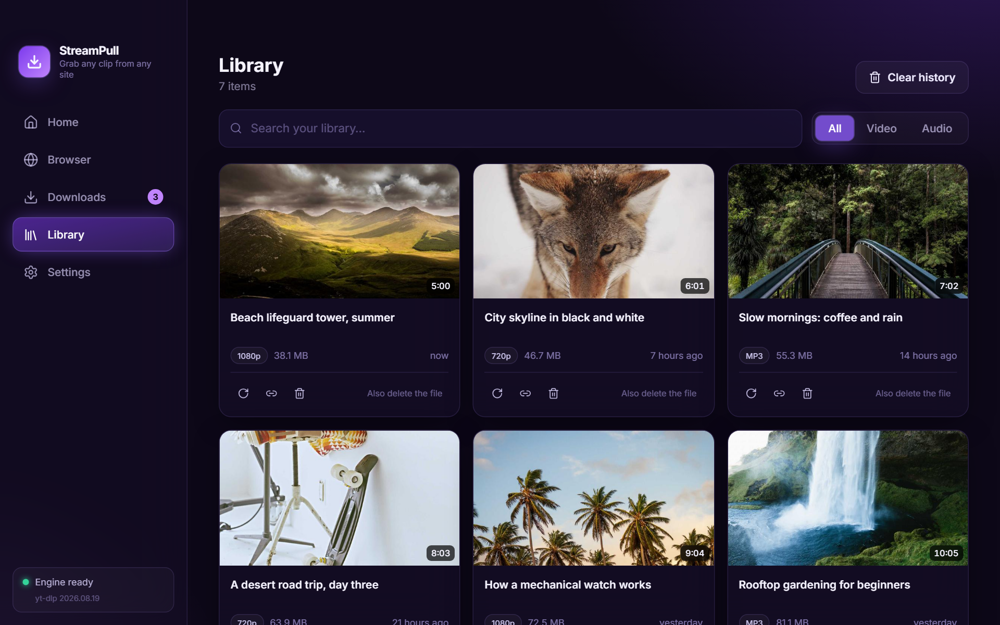
  
</p>
<p align="center">
  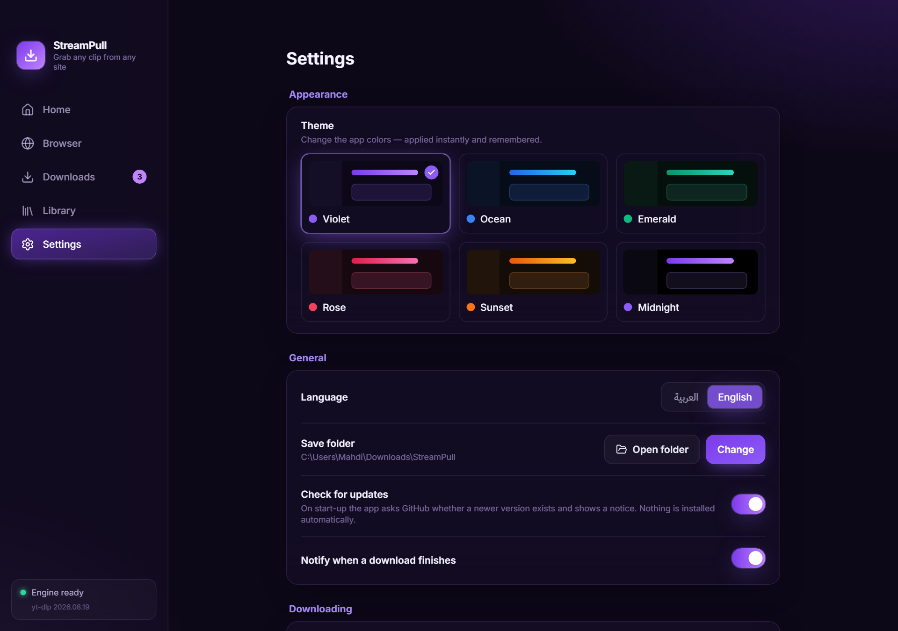
  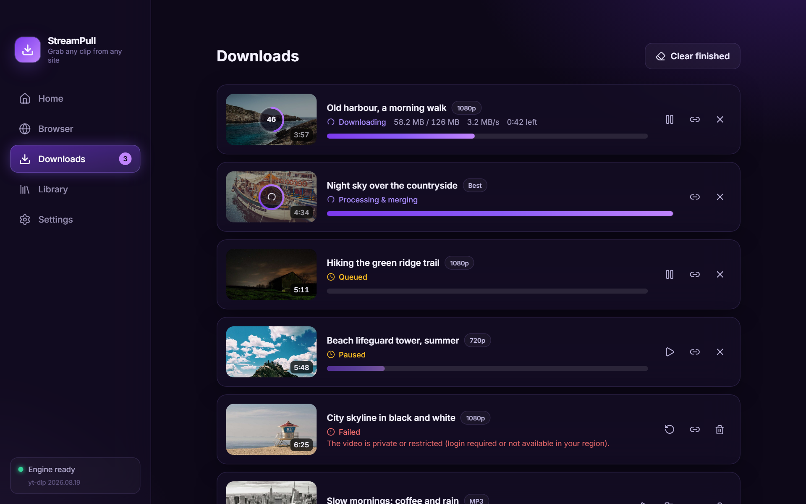
</p>

### Six color themes

Violet, Ocean, Emerald, Rose, Sunset and Midnight black — on the desktop and on Android, in Arabic and English.

<p align="center">
  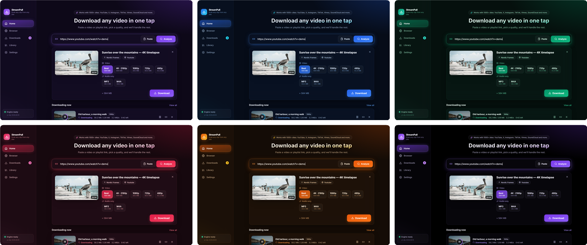
</p>

### On Android

<p align="center">
  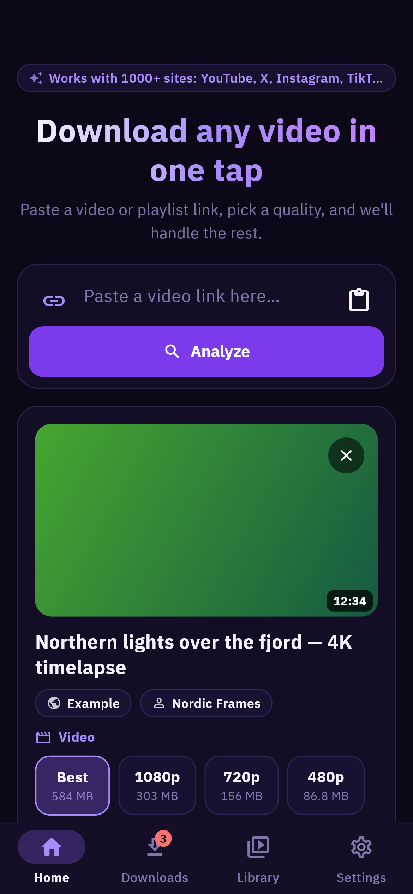
  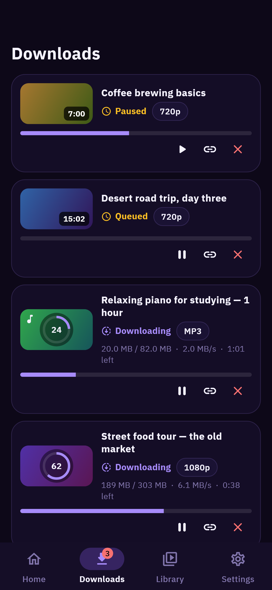
  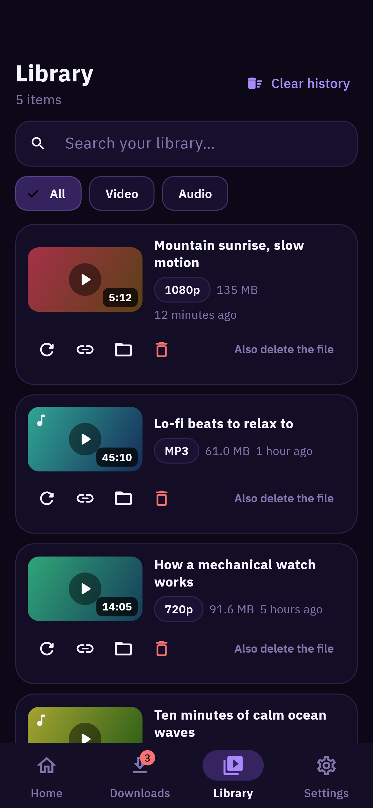
  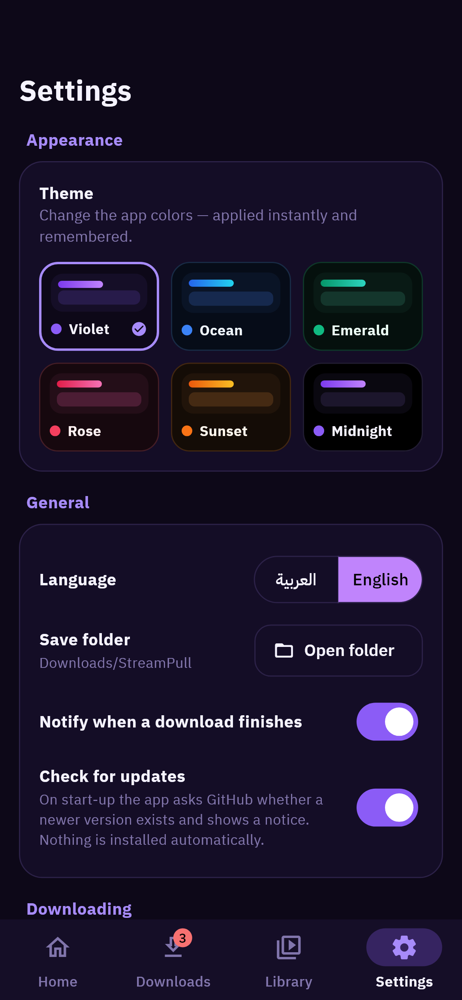
</p>
<p align="center">
  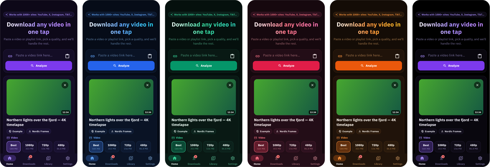
</p>

<details>
<summary>Arabic interface (right-to-left)</summary>

<p align="center">
  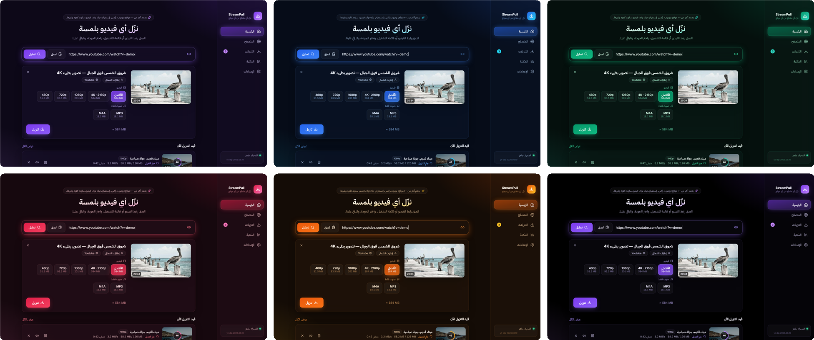
</p>
<p align="center">
  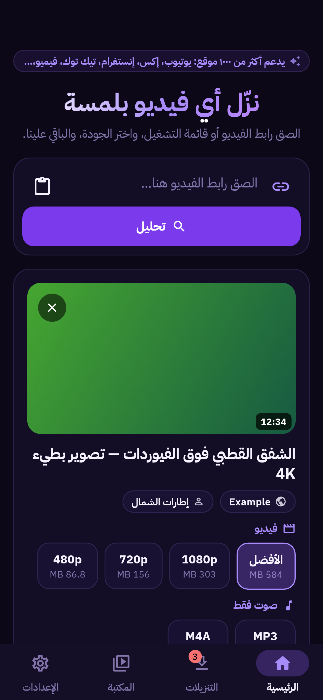
  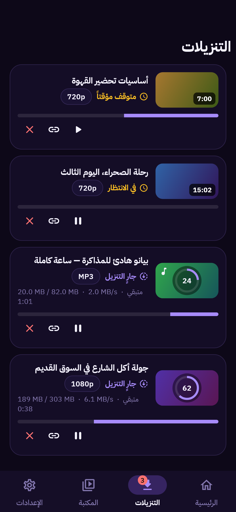
  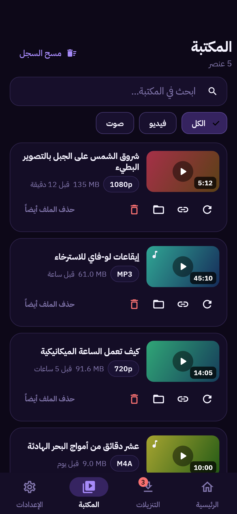
  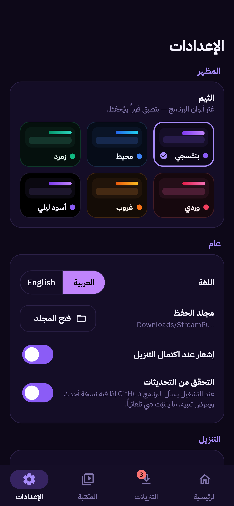
</p>
<p align="center">
  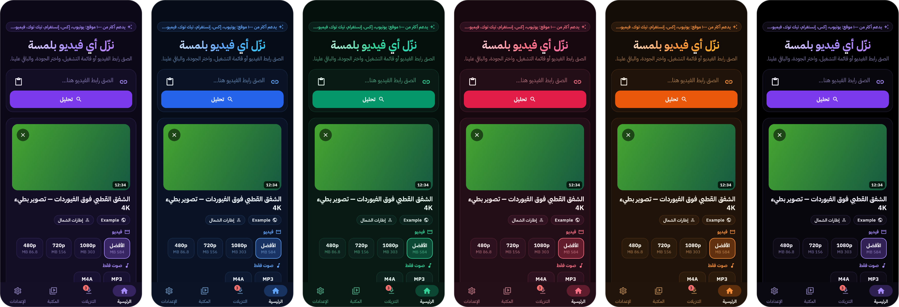
</p>

</details>

## Download

Get the latest build from the [**Releases**](../../releases) page. **Windows:**

| File | What it is |
| --- | --- |
| `StreamPull-Setup-x.y.z.exe` | Installer (adds a Start menu entry, uninstaller) |
| `StreamPull-x.y.z-portable.exe` | Portable — run it from anywhere, nothing to install |

**System requirements**

- Windows 10 or 11, 64-bit (Windows 7/8/8.1 and 32-bit Windows are not supported by Electron). Windows on ARM
  (Surface, Snapdragon laptops) works through Windows' x64 emulation.
- An internet connection the first time: the app downloads its two helper programs (yt-dlp and FFmpeg, ~50 MB).
  It follows your system proxy / VPN settings. If something goes wrong, **Settings → Download engine →
  Diagnostics** shows exactly what is blocked.
- Every push is tested end to end on clean Windows machines (Server 2022, Server 2025 and Windows 11 ARM), with
  Arabic-named folders and 175 % display scaling checked as well.

### Android

Starting with v0.4.0 the release page also has an **Android** app (built with Flutter, source in [`mobile/`](mobile)):
`StreamPull-x.y.z-android-arm64-v8a.apk` fits almost every phone from the last years (older 32‑bit phones:
`armeabi-v7a`; emulators: `x86_64`). It needs Android 10 or newer, you may have to allow "install unknown apps" for
your browser or file manager once, and you can **share a link from any app** (YouTube, TikTok, Instagram …) straight
to StreamPull. Files are saved to `Downloads/StreamPull`. The Android app is licensed GPL‑3.0 (see
[mobile/LICENSE](mobile/LICENSE)); it has no in‑app browser yet.

> **Coming soon:** macOS and Linux versions are planned for the next few days.
> Star or watch the repository to get notified when they land.

**The builds are not code‑signed yet**, so Windows SmartScreen may warn you the first time:
*More info → Run anyway*.

On first launch the app downloads **yt-dlp** and **FFmpeg** (about 50 MB, one time) into its own data folder.

## Build from source

**Desktop** — requires Node.js 22+. (The Android app is built differently, see [mobile/README.md](mobile/README.md).)

```bash
git clone https://github.com/Mahaadi-dis/streampull.git
cd streampull
npm ci
npm run dev          # run the app with hot reload
npm run typecheck    # TypeScript
npm test             # unit tests
npm run dist:win     # builds the Windows installer + portable exe into ./release
```

`dist:mac` and `dist:linux` also exist, but those platforms are **not released or tested yet** (coming soon).
Installers must be built on their own OS.

## How it works

```
renderer (React)  ──IPC──▶  main process (Electron)  ──spawn──▶  yt-dlp ──▶ FFmpeg
   UI / i18n / state          queue, history, settings            downloads, merging
                              embedded browser view  ─▶ sniffs network responses for media
```

- `src/main` — queue, yt-dlp/FFmpeg management, embedded browser + media sniffing, IPC (inputs are validated).
- `src/preload` — the small, typed `window.api` bridge (context isolation on, sandbox on).
- `src/renderer` — React UI, Tailwind, Framer Motion, Zustand, Arabic/English strings.
- `mobile` — the Android app: Flutter UI, the same download logic ported to Dart (tested with the same vectors), and a Kotlin
  download engine on [youtubedl-android](https://github.com/yausername/youtubedl-android). Every push is tested on an Android emulator in CI.
- The embedded browser runs in its own isolated session with **all permissions denied**, and the web content has no access to the app API.
- On start-up the app asks GitHub for the latest release and shows a notice if there is a newer one (turn it off in Settings). Nothing is downloaded or installed automatically.

## Limitations

- **DRM‑protected** services (Netflix, Disney+, …) are not supported and never will be.
- Signing in with a **Google account** inside the built‑in browser is often blocked by Google.
- The ad blocker needs an internet connection the first time to download its filter lists (EasyList / EasyPrivacy, refreshed weekly); until then a small built-in list of ad networks is used.
- The Android app has no built-in browser yet (the desktop app does), and the APKs are not on Google Play — Google does not allow
  downloaders for sites like YouTube there, so you install the APK from the Releases page.
- macOS and Linux versions are coming soon (see above).

## Legal

StreamPull is a general‑purpose tool. **Only download content you own or are allowed to download**, and respect
copyright law and each site's terms of service. The authors do not endorse piracy and are not responsible for how
the software is used. The app does not circumvent DRM.

## Contributing

Issues and pull requests are welcome — see [CONTRIBUTING.md](CONTRIBUTING.md).
Translations are just two JSON files under `src/renderer/src/i18n/`.

## License

The desktop app is [MIT](LICENSE). The Android app in [`mobile/`](mobile) is [GPL‑3.0](mobile/LICENSE), because it bundles
`youtubedl-android`. Third‑party components are listed in [THIRD_PARTY_NOTICES.md](THIRD_PARTY_NOTICES.md).
